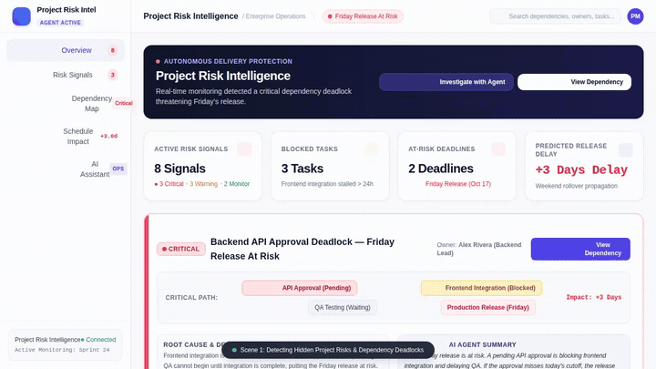

# Project Sentinel — Project Risk Intelligence Agent



> **Autonomous AI-powered operations agent that detects hidden dependencies, blocked tasks, and project delivery risks before deadlines slip.**

---

## Overview

Modern engineering and operations teams face invisible delivery bottlenecks: unanswered Slack questions, stalled partner approvals, unassigned dependencies, and weekend calendar rollovers. 

**Project Sentinel** continuously monitors team activity and task records, detects cross-functional deadlocks, deterministically calculates critical-path slippage, and drafts targeted escalation messages for responsible stakeholders.

---

## What the Agent Actually Does

Based on the implemented codebase in `app/`, the agent executes an evidence-backed triage workflow:

### 1. Active Risk & Dependency Management (Google Cloud Firestore)
* **`list_risk_signals`**: Queries Firestore (`risk_signals` collection) for open blockers filtered by severity (`CRITICAL`, `WARNING`, `MONITOR`) and status (`OPEN`, `INVESTIGATING`, `RESOLVED`).
* **`get_risk_signal`**: Retrieves complete metadata for a specific blocker (root cause, affected deadline, blocked party, owner).
* **`create_risk_signal`**: Logs newly detected delivery risks and dependency deadlocks directly into Firestore.
* **`update_risk_signal`**: Updates risk statuses and records stakeholder resolution notes.

### 2. Team Communication Triage (Google Cloud Firestore)
* **`fetch_team_activity_feed`**: Scans channel threads in Firestore (`team_activity` collection) to detect unanswered questions, communication delays exceeding 24 hours, and unconfirmed handoffs.
* **`log_team_message`**: Ingests chat records into the activity stream.

### 3. Deterministic Schedule Math (No LLM Hallucinations)
* **`calculate_schedule_slip`**: Uses deterministic business-day and calendar arithmetic to project milestone breach dates. Accounts for:
  * Net stalled days beyond available contingency buffer.
  * Weekend rollover penalties (tasks delayed into Friday that slip through Saturday/Sunday).
  * True calendar delivery slip.

### 4. Distributed Calendar & Holiday Verification
* **`check_upcoming_public_holidays`**: Queries the public Nager.Date API for upcoming national and bank holidays across distributed team regions (e.g., US, UK, DE) that could extend approval delays.

### 5. Visual Bottleneck Infographics (Vertex AI & Cloud Storage)
* **`generate_blocker_diagram`**:
  * Uses the **`gemini-3.1-flash-lite-image`** model in Vertex AI (`global` region) to synthesize visual dependency flowcharts.
  * Persists the generated image to the agent session via `ToolContext.save_artifact`.
  * Uploads raw image bytes directly to a public **Google Cloud Storage (GCS)** bucket to produce web-ready HTTPS URLs.

### 6. Targeted Stakeholder Escalation
* **`draft_escalation_message`**: Crafts role-specific, diplomacy-tuned escalation drafts tailored for Slack, Email, or Jira.
* **`dispatch_escalation`**: Dispatches approved notifications via outgoing webhooks or updates resolution records.

---

## Google Cloud Services Wired Up

| Service | Status | Role in Project Sentinel |
| :--- | :--- | :--- |
| **Google Cloud Firestore** | **Active** | Primary persistence layer for `risk_signals` and `team_activity` feeds. |
| **Vertex AI Image Generation** | **Active** | Generates visual bottleneck infographics via `gemini-3.1-flash-lite-image`. |
| **Google Cloud Storage (GCS)** | **Active** | Stores and serves generated diagram assets via dedicated bucket storage. |
| **Agent Engine / Agent Runtime (ADK)** | **Active** | Hosts the deployed reasoning engine speaking the Agent-to-Agent (A2A) protocol. |
| **Vertex AI Memory Bank** | *Planned, not yet implemented* | Long-term cross-session user memory is planned; current implementation uses ADK session state. |
| **A2UI Rendering** | *Planned, not yet implemented* | Rich dynamic card UI callback; current implementation returns markdown text and session artifacts. |

---

## Architecture

```
┌────────────────────────────────────────────────────────┐
│               Frontend Dashboard (FastAPI)              │
│       Executive KPIs • Topology Map • AI Assistant      │
└───────────────────────────┬────────────────────────────┘
                            │ A2A Protocol (HTTP / ADC)
                            ▼
┌────────────────────────────────────────────────────────┐
│             Project Sentinel Agent (ADK)               │
│        Model: Gemini 3.8 Flash • Reasoning Engine      │
└───────┬───────────────┬────────────────┬───────────────┘
        │               │                │
        ▼               ▼                ▼
 ┌─────────────┐ ┌─────────────┐  ┌─────────────┐
 │  Firestore  │ │  Vertex AI  │  │   Cloud     │
 │  Database   │ │ Image Model │  │  Storage    │
 └─────────────┘ └─────────────┘  └─────────────┘
```

---

## Local Development & Setup

### Prerequisites
* Python 3.11+
* Google Cloud CLI (`gcloud`) authenticated with Application Default Credentials:
  ```bash
  gcloud auth application-default login
  ```

### 1. Agent Setup (Backend)

Install project dependencies and build the ADK environment:
```bash
# In project root
uv sync
agents-cli install
```

Run test suite:
```bash
uv run pytest
```

Run the agent locally via ADK:
```bash
agents-cli run
```

### 2. Frontend Dashboard Setup

The dashboard connects to the agent via an A2A proxy layer:

```bash
cd frontend
python3 -m venv .venv
source .venv/bin/activate
pip install -r requirements.txt

# Configure agent engine target
export AGENT_ENGINE_RESOURCE_NAME="projects/<PROJECT_ID>/locations/<REGION>/reasoningEngines/<ENGINE_ID>"
export AGENT_DIRECTORY="app"

# Start dashboard server
python main.py
```

### 3. Deploying to Agent Platform

Deploy the agent code to Google Cloud Agent Runtime:
```bash
agents-cli deploy
```

---

## Repository Structure

```
.
├── app/
│   ├── agent.py               # Root ADK agent definition & instructions
│   ├── activity_tools.py      # Firestore team communication feed tools
│   ├── firestore_tools.py     # Firestore risk signal CRUD tools
│   ├── schedule_tools.py      # Deterministic schedule slip & weekend math
│   ├── holiday_tools.py       # Public holidays verification tool
│   ├── image_tools.py         # Gemini image generation & GCS upload tool
│   └── escalation_tools.py    # Stakeholder escalation drafting tools
├── frontend/
│   ├── main.py                # FastAPI A2A client proxy
│   ├── static/index.html      # Project Risk Intelligence dashboard UI
│   └── Dockerfile             # Production container definition
├── scripts/
│   └── record_full_demo.py    # Playwright automated 5-scene demo recorder
├── agents-cli-manifest.yaml   # ADK project deployment manifest
├── pyproject.toml             # Python dependencies
└── README.md                  # Project documentation
```

---

## License

Apache 2.0. Copyright 2026 Google LLC.
